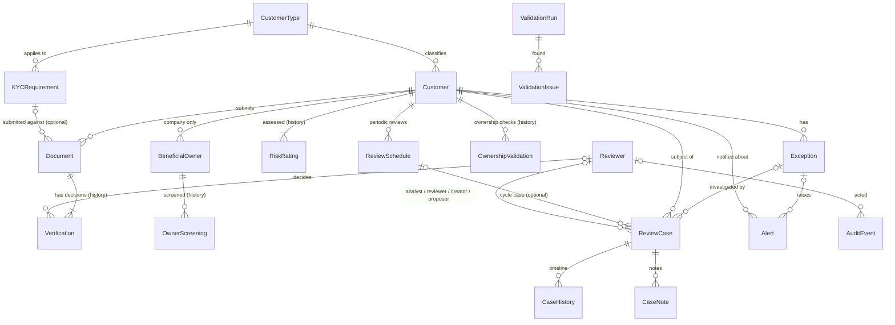

# Database Relationships

> **Phase 2 additions.** Two tables and two foreign keys were added after this document was written: `CompanyOwnership` (`company_customer_id` -> `Customer.id`, `beneficial_owner_id` -> `BeneficialOwner.id`, both `ON DELETE CASCADE`) and the stand-alone counter table `IdCounter` (no foreign keys). The sections below describe the schema **before** that migration; see `ownership_model.md` and `id_conventions.md` for the new objects.

This document explains how the tables of the ClearKYC database are connected, based on the **actual** schema (`prisma/schema.prisma` and the five migrations). The 37 foreign keys below were read from the live PostgreSQL catalogue.

For every column, see `data_dictionary.md`.

## 1. The big picture

A **Customer** is the centre. Documents, risk ratings, beneficial owners (for companies), exceptions, alerts, review cases and review schedules all belong to a customer. A **Reviewer** is a person who acts on things. The **AuditEvent** table records what people did and deliberately has no foreign key to the records it describes.

Reading the symbols: `||` exactly one, `|o` zero or one, `o{` zero or many, `|{` one or many.

## 2. All foreign keys (child → parent)

| Child column (the table that points) | Parent (the table pointed at) | Link is | If the parent is deleted |
|---|---|---|---|
| Customer.customer_type_id | CustomerType.id | required | RESTRICT (blocked) |
| KYCRequirement.customer_type_id | CustomerType.id | required | RESTRICT |
| Document.customer_id | Customer.id | required | RESTRICT |
| Document.requirement_id | KYCRequirement.id | optional | SET NULL |
| Verification.document_id | Document.id | required | RESTRICT |
| Verification.reviewer_id | Reviewer.id | optional (empty for the system's first "Pending" row) | RESTRICT |
| RiskRating.customer_id | Customer.id | required | CASCADE |
| RiskRating.assessed_by_id | Reviewer.id | optional | RESTRICT |
| BeneficialOwner.customer_id | Customer.id | required (must be a Company) | CASCADE |
| BeneficialOwner.created_by_id / updated_by_id | Reviewer.id | optional | RESTRICT |
| OwnerScreening.beneficial_owner_id | BeneficialOwner.id | required | CASCADE |
| OwnerScreening.screened_by_id | Reviewer.id | optional | RESTRICT |
| OwnershipValidation.customer_id | Customer.id | required | CASCADE |
| OwnershipValidation.checked_by_id | Reviewer.id | optional | RESTRICT |
| Exception.customer_id | Customer.id | required | CASCADE |
| Exception.resolved_by_id | Reviewer.id | optional | RESTRICT |
| ReviewSchedule.customer_id | Customer.id | required | CASCADE |
| ReviewSchedule.completed_by_id | Reviewer.id | optional | RESTRICT |
| ReviewCase.customer_id | Customer.id | required | CASCADE |
| ReviewCase.exception_id | Exception.id | optional | SET NULL |
| ReviewCase.review_schedule_id | ReviewSchedule.id | optional | SET NULL |
| ReviewCase.assigned_analyst_id, assigned_reviewer_id, created_by_id, proposed_by_id | Reviewer.id | optional | RESTRICT |
| CaseHistory.review_case_id | ReviewCase.id | required | CASCADE |
| CaseHistory.changed_by_id | Reviewer.id | optional (empty = system) | RESTRICT |
| CaseNote.review_case_id | ReviewCase.id | required | CASCADE |
| CaseNote.author_id | Reviewer.id | required | RESTRICT |
| Alert.customer_id | Customer.id | required | CASCADE |
| Alert.exception_id | Exception.id | optional | SET NULL |
| Alert.acknowledged_by_id, resolved_by_id | Reviewer.id | optional | RESTRICT |
| AuditEvent.user_id | Reviewer.id | optional (empty = system) | RESTRICT |
| ValidationRun.created_by_id | Reviewer.id | optional | RESTRICT |
| ValidationIssue.validation_run_id | ValidationRun.id | required | RESTRICT |

**What the delete rules mean in practice.** A customer that has documents cannot be deleted (Document uses RESTRICT), so verified evidence is never lost by accident. Everything else about a customer (ratings, owners, exceptions, alerts, cases, schedules) goes with it if the customer is removed, but the immutability triggers only allow that cascade or an explicit maintenance switch, so history cannot be deleted through the normal application. People (`Reviewer`) can never be deleted while any record points at them.

## 3. Cardinality of each relationship

### One-to-many (the normal case)

| Parent | Child | Meaning |
|---|---|---|
| CustomerType | Customer | A type has many customers; a customer has exactly one type. |
| CustomerType | KYCRequirement | A type has many requirements (by risk level and document). |
| Customer | Document | A customer submits many documents (up to 5 in the current data). |
| KYCRequirement | Document | A requirement can be satisfied by many documents over time; a document may satisfy none (extra evidence). |
| Document | Verification | **1:N history.** At least one row (the system's "Pending"); the newest row is the current status. |
| Customer | RiskRating | **1:N history.** At least one rating from onboarding; the newest is current. |
| Customer | BeneficialOwner | A company has many owners. Individuals have none (trigger). |
| BeneficialOwner | OwnerScreening | **1:N history.** One owner can be screened many times, for PEP and for sanctions. |
| Customer | OwnershipValidation | **1:N history** of recorded ownership checks. |
| Customer | Exception, Alert, ReviewCase, ReviewSchedule | A customer can have many of each. |
| Exception | ReviewCase | One exception can have several cases over time (one active at a time). |
| Exception | Alert | One condition raises at most one active alert at a time; closed ones stay as history. |
| ReviewSchedule | ReviewCase | A schedule cycle has at most one active periodic case. |
| ReviewCase | CaseHistory, CaseNote | A case has a full timeline and notes. |
| Reviewer | (many tables) | A person acts on many records. |
| ValidationRun | ValidationIssue | A run finds many issues. |

### One-to-one

There is **no strict one-to-one** foreign key in the schema. Two "effectively one-to-one" situations exist, both enforced by partial unique indexes rather than by the table shape:

| Situation | Enforced by |
|---|---|
| A customer has at most **one current** (`Scheduled`) review schedule | unique index `ReviewSchedule(customer_id) WHERE status = 'Scheduled'` |
| A customer and cycle have at most **one active** periodic review case | unique index `ReviewCase(customer_id, periodic_cycle) WHERE case_type = 'Periodic KYC Review' AND status NOT IN ('Resolved','Closed')` |
| A condition has at most **one active** exception / alert | unique indexes on `dedupe_key`, only for rows that are still active |

A document's "current verification" and a customer's "current risk rating" are also one-to-one in meaning, but they are *derived* (the newest history row), not stored as a link.

### Many-to-many

There are **no bridge tables** and no true many-to-many relationships stored in the schema. The relationship that *should* be many-to-many is:

| Relationship | Today | Gap |
|---|---|---|
| Company ↔ Beneficial owner (a person can own several companies, with a different share in each) | One row in `BeneficialOwner` per person **per company**; the percentage lives on that row | The same person owning two companies becomes two unrelated rows (duplicated personal data and separate screening history). No effective dates. See `ownership_model.md` |

Other links that look many-to-many but are not modelled as such:

| Link | How it is actually done |
|---|---|
| KYCRequirement ↔ document type | Compared by **text** (`document_type`), not a foreign key. There is no DocumentType table (the list is in `config/kycRules.js`). |
| Reviewer ↔ ReviewCase | Four separate foreign keys on the case (analyst, reviewer, creator, proposer), not a bridge. |

## 4. Soft links (no foreign key on purpose)

| Column | Points at | Why there is no foreign key |
|---|---|---|
| Exception.source_entity_type + source_entity_id | A Document, KYCRequirement, BeneficialOwner, Customer, ReviewSchedule or ReviewCase | One column cannot reference several tables |
| Alert.related_entity_type + related_entity_id | the same set | the same reason; checked by the data quality check `ALERT_ACTIVE_VALID` |
| AuditEvent.entity_type + entity_id, AuditEvent.customer_id | Any record | The audit trail must survive the deletion of the record it describes |
| ValidationIssue.entity_type + entity_id, customer_id | Any record | Same reason |
| Document.document_type vs KYCRequirement.document_type | text match | See above |

## 5. Optional relationships (can be empty)

`Document.requirement_id` (extra evidence), `ReviewCase.exception_id` (manually created case), `ReviewCase.review_schedule_id` (non-periodic case), `Alert.exception_id`, and every "who did it" column on history and workflow tables (empty means the system did it).

## 6. Effective dates and lifecycle states

| Table | Effective dates | Lifecycle states |
|---|---|---|
| KYCRequirement | `effective_from` .. `effective_to`, plus `is_active` | active / inactive; in effect when today is inside the dates |
| Document | `issue_date` .. `expiry_date` | Pending → In Review → Verified / Rejected / Requires Resubmission; **Expired** is derived from `expiry_date`, never stored |
| Verification | `verification_date` | Same five values; insert-only history |
| RiskRating | `assessment_date` | Completed / Requires Manual Review; newest row is current |
| BeneficialOwner | none (only `created_at`, `updated_at`) | no lifecycle; edits overwrite the row (the audit trail keeps the old values) |
| ReviewSchedule | `last_review_date` .. `next_review_date` | Scheduled → Completed, or Superseded |
| Exception | `detected_at` .. `resolved_at` | Open → In Review → Resolved |
| ReviewCase | `created_at`, `due_date`, `resolved_at`, `closed_at` | Open → Assigned → In Progress ⇄ Pending Customer → Escalated → Resolved → Closed (reopen allowed) |
| Alert | `created_at`, `due_date`, `acknowledged_at`, `resolved_at` | New → Acknowledged → In Progress → Resolved or Dismissed |

## 7. History that is never overwritten

| Table | Protection |
|---|---|
| Verification, RiskRating, OwnerScreening, OwnershipValidation, CaseHistory, CaseNote | Triggers refuse UPDATE and DELETE (delete only by cascade from a customer or the maintenance switch) |
| AuditEvent | Triggers refuse UPDATE, DELETE and TRUNCATE (delete/truncate only with the maintenance switch) |
| Exception (resolved), Alert (closed), ReviewSchedule (not current) | A trigger freezes them once final; a returning condition creates a new row |
| ReviewCase, Exception, Alert, ReviewSchedule, ValidationRun, ValidationIssue | Direct delete is refused |

## 8. What the current structure cannot express

* The same person owning several companies **as one person** (see `ownership_model.md`).
* A history of ownership percentages over time (who owned how much, and from when to when).
* Business codes for requirements, documents and review cases in the required formats (see `id_conventions.md`).
* Configurable expiry lead times (see `expiry_configuration.md`).
